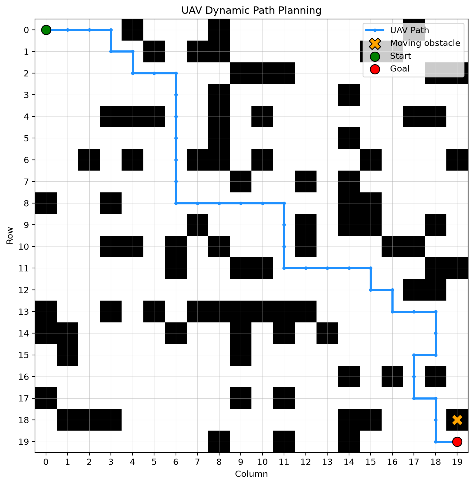
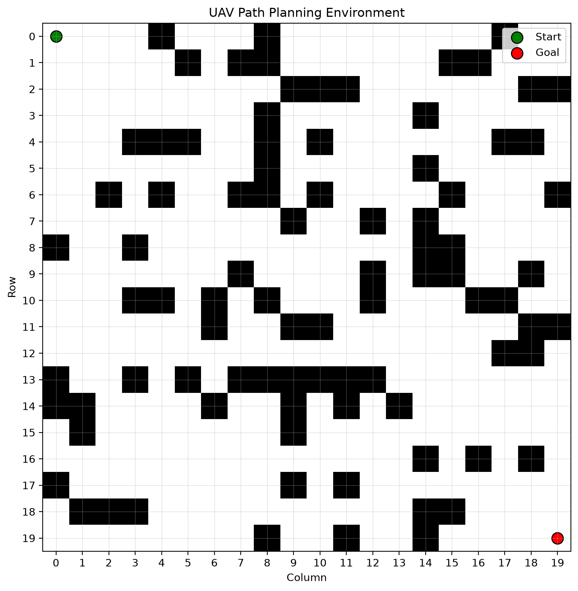
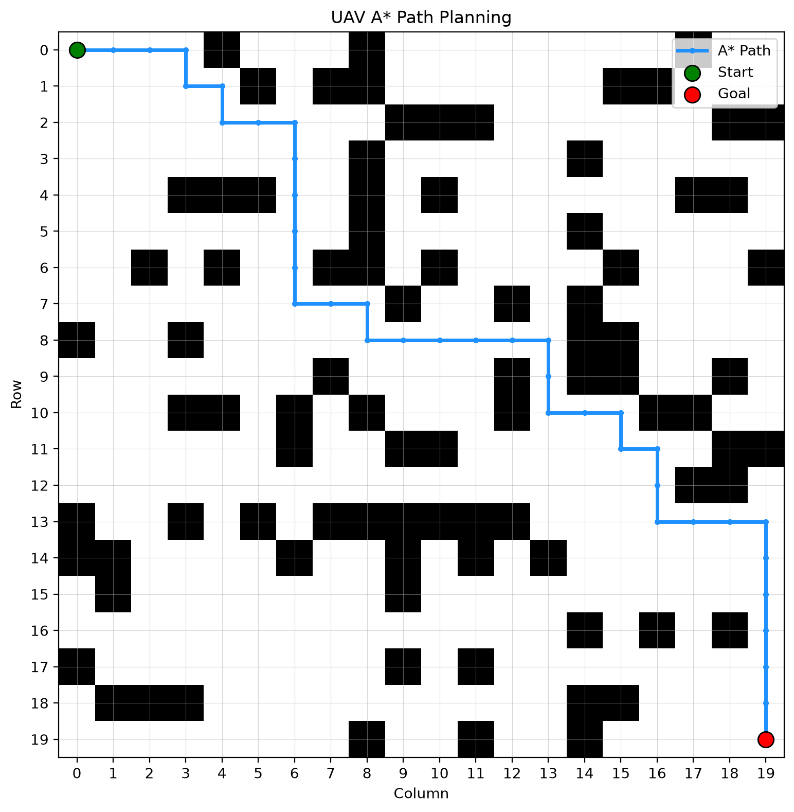
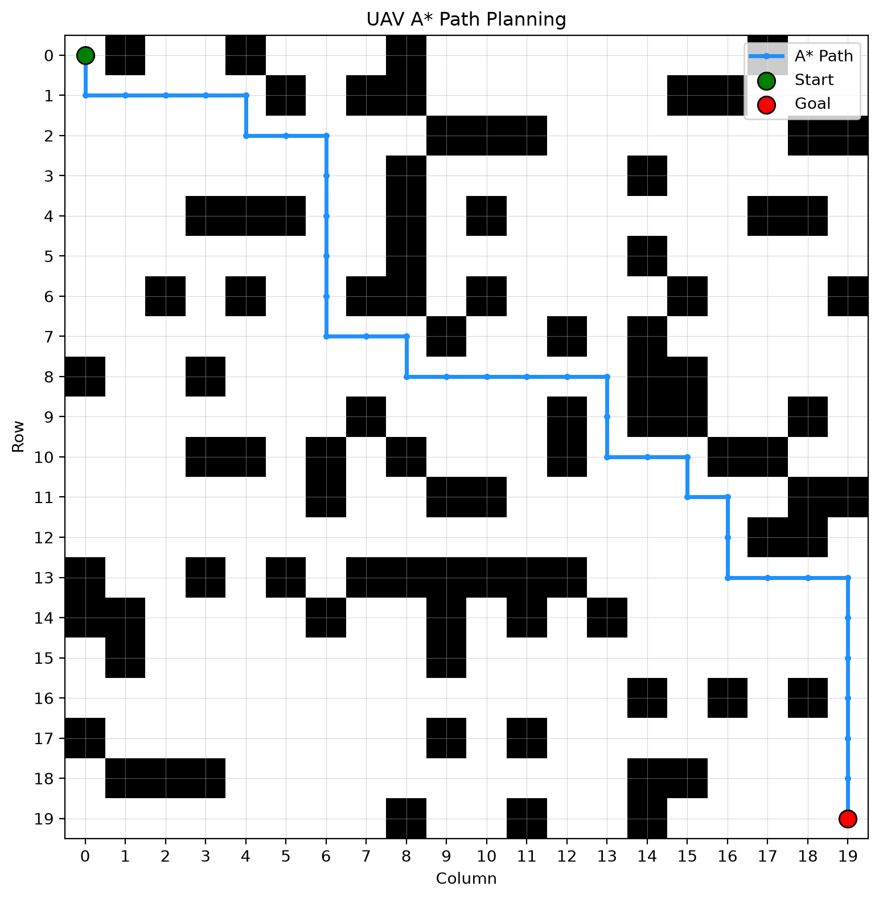
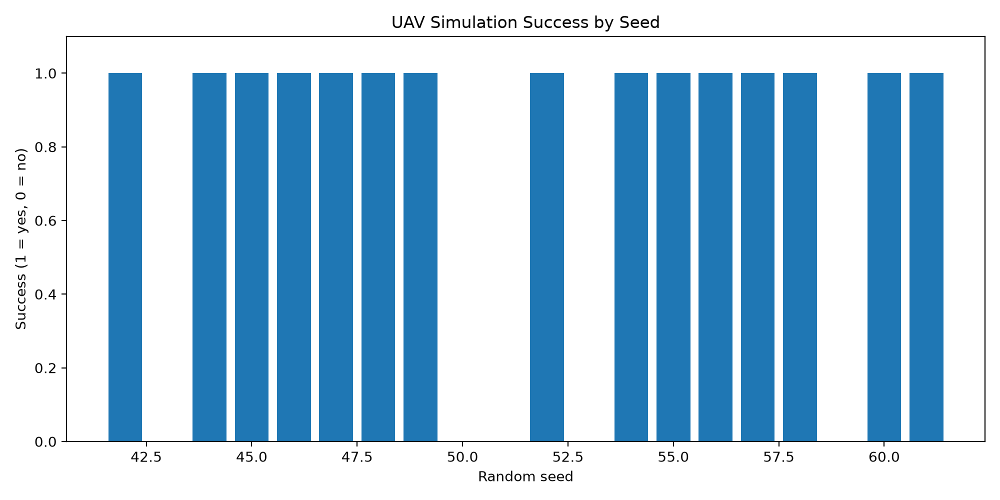
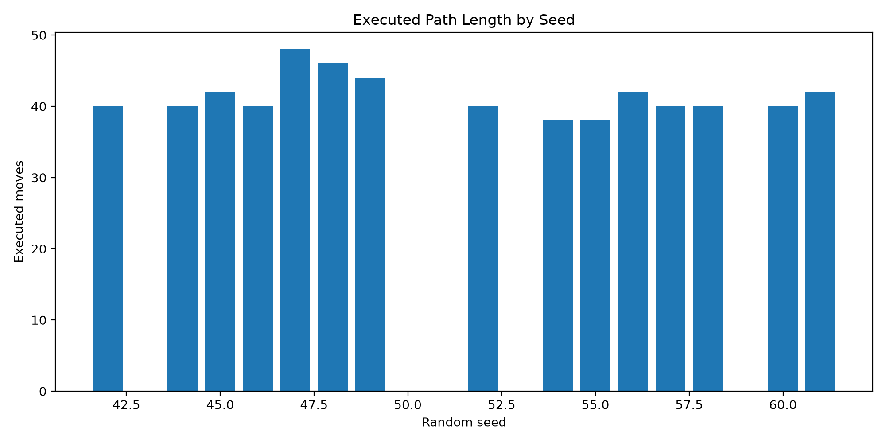
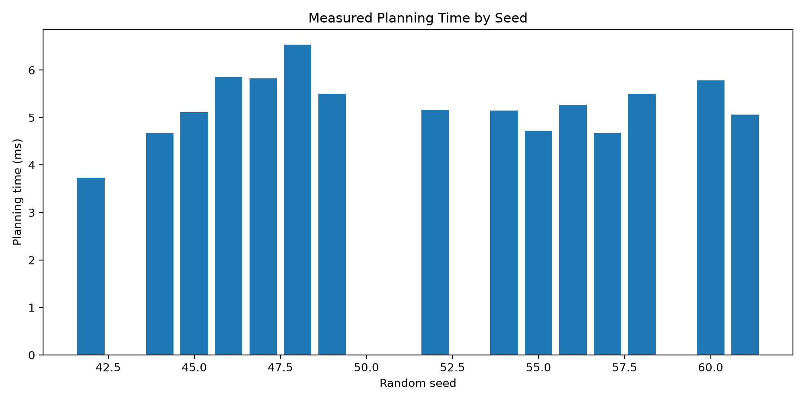
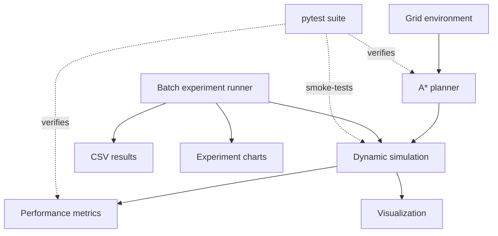

<div align="center">

# UAV Dynamic Path Planning

**A* path planning · Dynamic obstacle replanning · Reproducible experiments**

A Python simulation for studying how a UAV can plan a route through an obstacle-filled environment and replan as a controlled environment changes.

<p>
  
  
  
  <a href="https://github.com/Md-sakibur/uav-dynamic-path-planning/actions/workflows/tests.yml"></a>
</p>

<p>
  
</p>

</div>

---

## Overview

A route that is valid at the start of a mission may become unsuitable when the environment changes. This project explores that problem in a controlled, two-dimensional grid simulation.

The simulator generates a seeded obstacle map, calculates an initial route using **A* search**, updates a simulated obstacle along positions on the original route, and repeatedly replans from the UAV's current grid position. It also records basic performance measures and supports batch experiments across multiple random seeds.

> **Scope and safety:** This is a grid-based software prototype. It is not a real-drone navigation system and does not implement sensor-based obstacle tracking, uncertain motion prediction, vehicle dynamics, or physical-flight validation.

## At a glance

| Component | Current implementation |
|---|---|
| Environment | Seeded 2D grid with static blocked cells |
| Planner | A* with Manhattan-distance heuristic |
| Movement | Four-connected grid moves; one move per step |
| Dynamic scenario | One simulated obstacle advances along positions from the initial route |
| Replanning | A* is rerun from the current UAV cell at each simulation step |
| Evaluation | Success, path length, planning time, replanning count, collision count |
| Batch experiments | 20 seeds: 42 through 61 |
| Automated tests | 6 tests in the current suite |

## Visual results

### 1. Environment generation

The environment is a 20 × 20 grid by default. A cell is either free or blocked; the start and goal cells are kept free.

<p align="center">
  
</p>

### 2. Initial A* route

A* searches for a route from the upper-left start to the lower-right goal without entering blocked cells.

<p align="center">
  
</p>

### 3. Replanning after an obstacle blocks the route

This earlier controlled example places an obstacle on the original route and calculates an alternative path.

<p align="center">
  
</p>

### 4. Multi-step obstacle updates

The multi-step simulation changes the obstacle position over successive steps and recalculates a route from the UAV's current location.

<p align="center">
  
</p>

### 5. Batch experiment charts

<p align="center">
  
</p>

<p align="center">
  
  
</p>

Raw observations for each attempted seed are stored in [`results/experiment_results.csv`](results/experiment_results.csv). Additional implementation details and interpretation are in [`docs/experiment_notes.md`](docs/experiment_notes.md).

## How it works

1. **Generate a map.** Create a grid using a specified random seed and obstacle probability.
2. **Plan a route.** Use A* to search from the start to the goal.
3. **Update the scenario.** Place the simulated obstacle at a new candidate position along the original path.
4. **Replan.** Run A* again from the UAV's current cell against the updated grid.
5. **Record metrics.** Measure the route length, number of planning/replanning calls, planning time, success, and simulated collisions.
6. **Repeat.** Run the process across a set of random seeds and write results to CSV.

### A* heuristic

The implementation uses Manhattan distance, appropriate for four-directional movement with unit-cost steps:

\[
h(n)=|r_n-r_g|+|c_n-c_g|
\]

A* prioritizes nodes according to the known cost so far plus the heuristic estimate:

\[
f(n)=g(n)+h(n)
\]

### Architecture



## Preliminary experiment results

A recorded batch evaluated **20 seeds, from 42 through 61**.

| Result | Observation |
|---|---:|
| Scenarios attempted | 20 |
| Successful journeys | 15 |
| Scenarios with no initial path | 5 |
| Overall success rate | 75% |
| Detected collisions among completed simulations | 0 |

The five unsuccessful cases had no initial route through their generated static grids. They should not be interpreted as failures caused by the moving obstacle. In the 15 cases that completed, the simulation reported zero collisions under its own grid checks.

These are **preliminary observations from one batch**, not a general performance guarantee or a comparison proving superiority over another planner. The simulation uses known grid occupancy, and the obstacle-update logic only accepts positions that preserve the possibility of reaching the goal. The results therefore do not establish safety under arbitrary obstacle motion, imperfect perception, or real flight conditions.

**Timing methodology:** The reported planning-time fields include the explicitly timed initial and per-step A* calls. Auxiliary A* calls used to screen candidate obstacle locations and prepare the final visualization are not included. Timing is machine-dependent and should not be interpreted as a flight-control deadline guarantee.

## Getting started

### Requirements

- Python 3.13 was used during development.
- NumPy
- Matplotlib
- pytest (for tests)

### Install

In Windows Command Prompt:

```cmd
git clone https://github.com/Md-sakibur/uav-dynamic-path-planning.git
cd uav-dynamic-path-planning
py -m venv .venv
.venv\Scripts\activate.bat
python -m pip install -r requirements.txt
```

### Run the simulation

```cmd
python main.py
```

Alternatively:

```cmd
python -m src.simulation
```

The program prints performance metrics and saves the visualization to `results/dynamic_replanning.png`.

### Run the batch experiments

```cmd
python -m experiments.run_experiments
```

The runner evaluates seeds 42 through 61 and regenerates the CSV file and charts in `results/`.

### Run the test suite

```cmd
python -m pytest -v
```

## Repository layout

```text
uav-dynamic-path-planning/
├── src/
│   ├── environment.py          # Seeded grid generation
│   ├── astar.py                # A* search and heuristic
│   ├── simulation.py           # Dynamic-obstacle simulation
│   ├── metrics.py              # Performance calculations
│   └── visualization.py        # Grid and route plots
├── tests/
│   ├── test_astar.py
│   ├── test_metrics.py
│   └── test_simulation.py
├── experiments/
│   └── run_experiments.py      # Multi-seed batch run
├── results/                    # Figures and CSV observations
├── docs/
│   └── experiment_notes.md
├── .github/
│   └── workflows/
│       └── tests.yml            # Test automation on GitHub
├── main.py
├── requirements.txt
└── README.md
```

## Limitations

- The map is 2D and grid-based; diagonal moves and continuous coordinates are not modelled.
- Obstacle positions are known directly by the simulator. There is no sensor model, tracking filter, or motion-prediction component.
- The moving obstacle follows a simplified, deterministic update rule along positions on the initial route.
- Candidate obstacle updates are screened to preserve a route to the goal, so the scenario is controlled rather than adversarial.
- The collision counter reflects the simulator's grid-level checks, not physical collision risk for a UAV.
- The experiment results do not yet compare multiple planners under a comprehensive, matched protocol.
- No flight dynamics, wind, battery constraints, sensor noise, or real-drone tests are included.

## Future work

1. Compare A* with Dijkstra or other suitable baselines under the same maps and seeds.
2. Add explicit obstacle-state tracking and short-horizon motion prediction.
3. Model uncertain or noisy observations and evaluate robustness.
4. Investigate replanning strategies with measured trade-offs in path length and computation.
5. Extend grid paths toward smoother trajectories and UAV motion constraints.
6. Expand the experiment set and report statistical summaries across repeated trials.

## Related Project

This work builds on my earlier [UAV Path Planning Benchmark](https://github.com/Md-sakibur/uav-path-planning-benchmark), which focused on comparing classical path-planning algorithms in static grid environments. The present repository extends that work toward controlled obstacle changes and repeated path replanning.

## Author

**MD SAKIBUR RAHMAN SAKI**

---

*Research prototype for learning and evaluating grid-based UAV path planning. Results and limitations are reported as implemented; dynamic tracking, uncertainty-aware prediction, and physical UAV validation remain future work.*